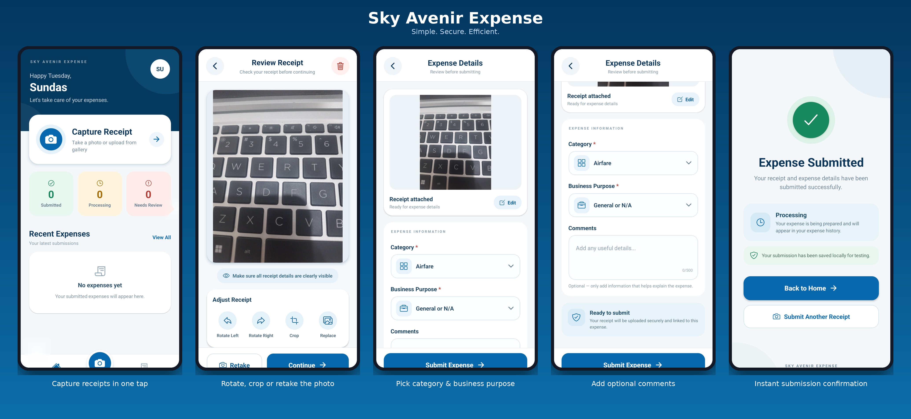
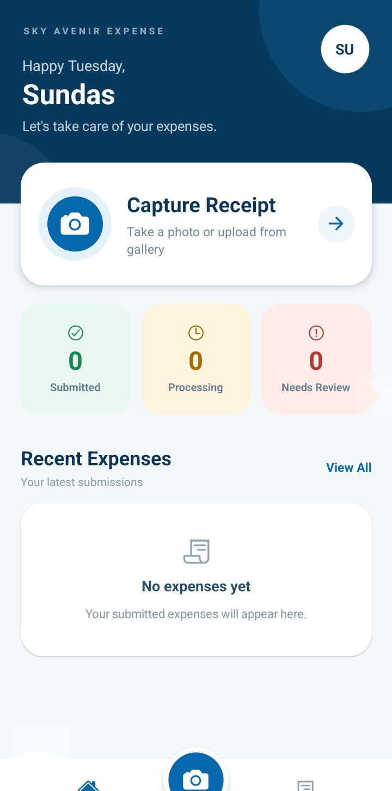
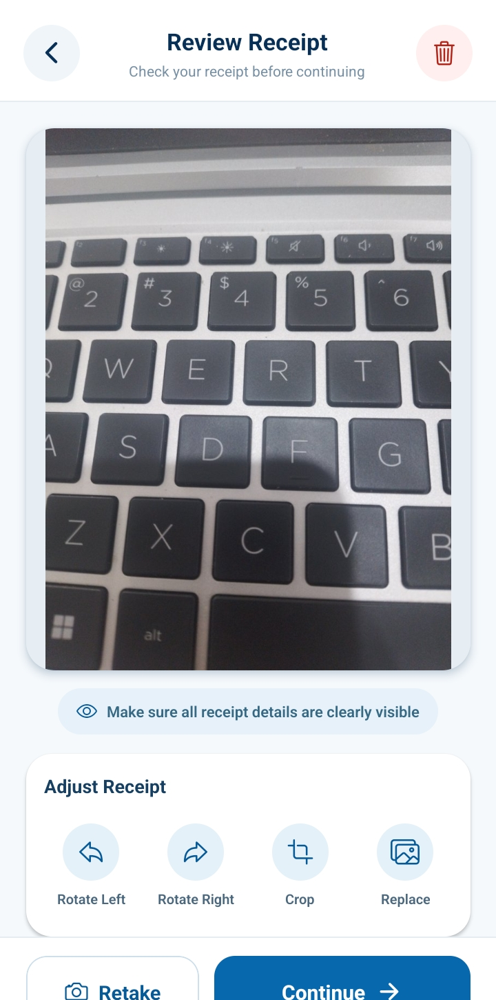
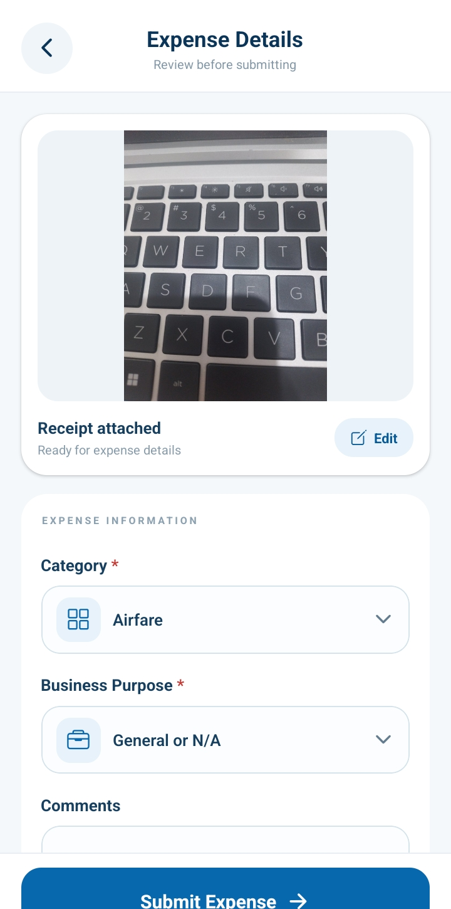
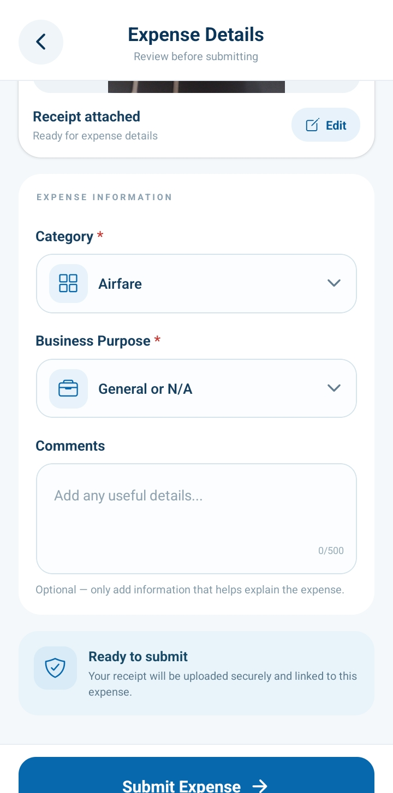
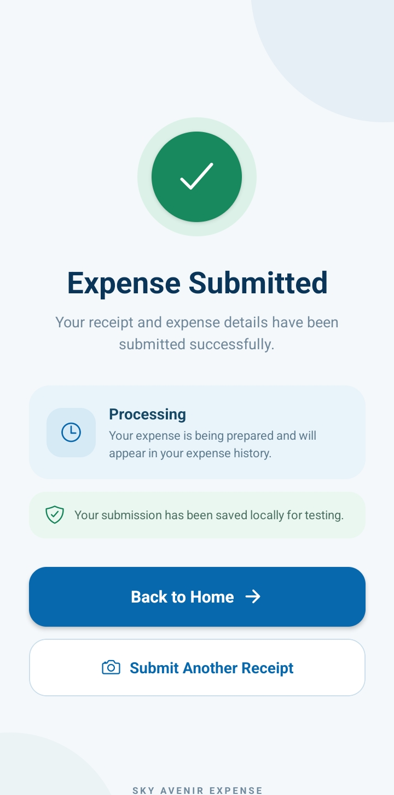

<div align="center">

# Sky Avenir Expense

**Simple. Secure. Efficient.**

A mobile app to capture receipts, categorize expenses and submit them in seconds.



</div>

---

## Features

- **One-tap receipt capture**: take a photo or upload from your gallery
- **Receipt review**: rotate, crop, replace or retake before continuing
- **Expense details**: choose a category, business purpose and add optional comments
- **Status dashboard**: see Submitted, Processing and Needs Review counts at a glance
- **Expense history**: all your submissions in one place
- **Confirmation screen**: clear feedback after every submission

## Screenshots

| Home | Review Receipt | Expense Details | Comments | Submitted |
|:---:|:---:|:---:|:---:|:---:|
|  |  |  |  |  |

## Tech Stack

- React Native (Expo)
- TypeScript / JavaScript
- Local storage (testing build)

## Getting Started

```bash
git clone https://github.com/sundas-stack/skyavenir-expense-app.git
cd skyavenir-expense-app
npm install
npx expo start
```

Scan the QR code with the Expo Go app, or press `a` to open it on an Android emulator.

## Download

Get the latest APK from the [Releases](https://github.com/sundas-stack/skyavenir-expense-app/releases) page and install it on your Android device. If prompted, allow "Install unknown apps".

## Roadmap

- [ ] Backend upload and sync
- [ ] OCR to auto-fill amount and date
- [ ] Expense history filters
- [ ] iOS build

## Author

**Sundas**: [GitHub](https://github.com/sundas-stack)
